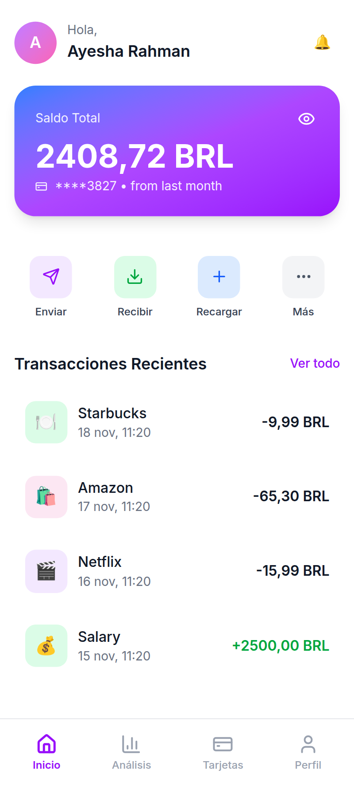
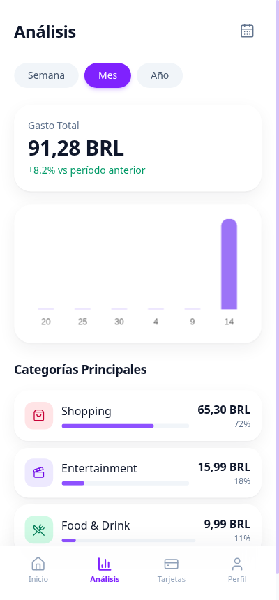
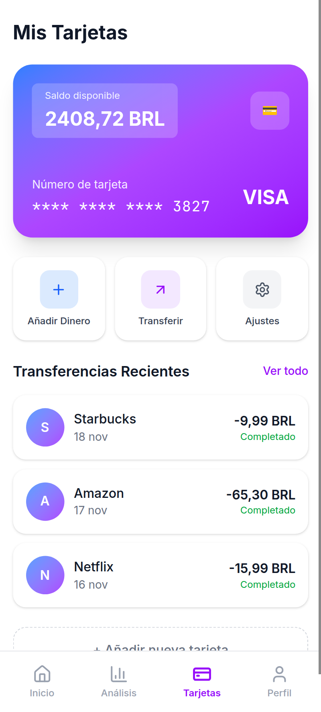
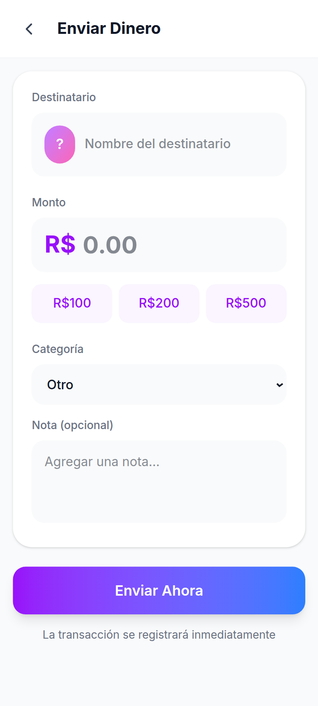
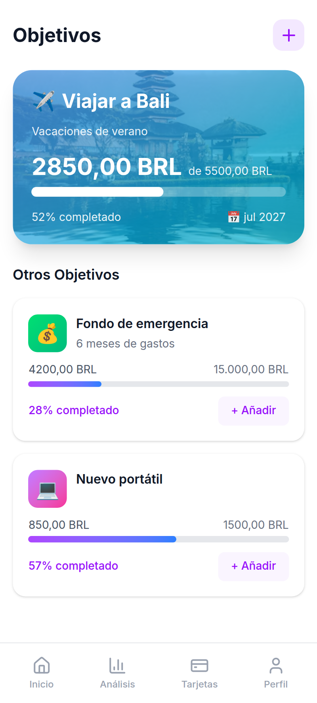
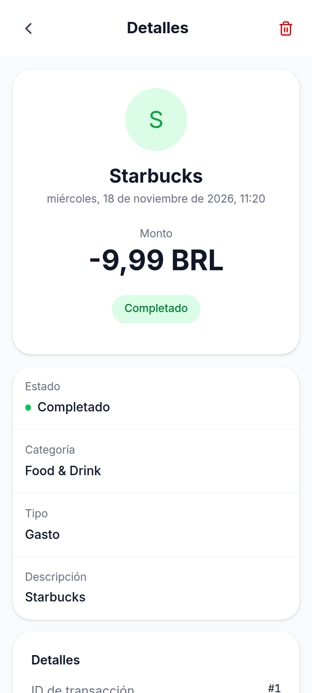
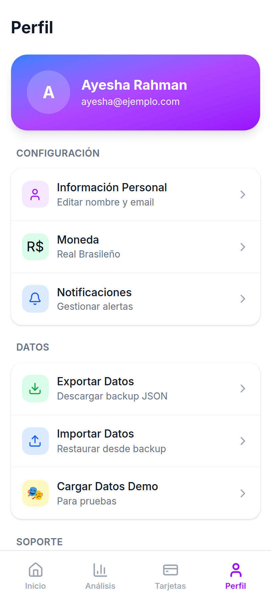

# 💰 Velora Finanzas

Aplicación web de finanzas personales moderna y funcional, construida con React, TypeScript y Tailwind CSS. Diseñada para ayudarte a gestionar tu dinero de manera inteligente y visual.


## ✨ Características

### 📊 Gestión Completa
- **Transacciones**: Registra ingresos, gastos y transferencias con categorías personalizadas
- **Cuentas**: Gestiona múltiples tarjetas y cuentas
- **Objetivos**: Define metas de ahorro y realiza seguimiento de tu progreso
- **Análisis**: Visualiza tus gastos con gráficos por semana, mes o año

### 💎 Características Técnicas
- ✅ **PWA Instalable**: Funciona como una app nativa en móvil y escritorio
- 💾 **Almacenamiento Local**: Todos tus datos se guardan de forma segura en tu navegador (IndexedDB)
- 🔒 **Sin Backend**: 100% privado, sin telemetría ni envío de datos
- 📱 **Mobile-First**: Diseño responsive optimizado para móviles
- 🌐 **Multimoneda**: Soporte para Reales Brasileños (BRL), Dólares (USD) y Euros (EUR)
- 💾 **Exportar/Importar**: Realiza backups de tus datos en formato JSON
- 🎭 **Datos de Demo**: Carga datos de ejemplo para probar la aplicación

### 🎨 Diseño
- Interfaz moderna con gradientes suaves
- Tarjetas con sombras sutiles (sin bordes duros)
- Iconos consistentes (Lucide React)
- Transiciones pulidas
- Paleta de colores violeta/azul

## 🚀 Capturas de Pantalla

### Pantalla Principal


### Análisis


### Mis Tarjetas


### Enviar Dinero


### Objetivos


### Detalles de Transacción


### Perfil y Configuración


## 🛠️ Tecnologías

- **React 18** - Biblioteca UI
- **TypeScript** - Tipado estático
- **Vite** - Build tool y dev server
- **Tailwind CSS** - Estilos utility-first
- **React Router** - Navegación
- **Localforage** - Almacenamiento IndexedDB
- **Chart.js** - Gráficos
- **Lucide React** - Iconos
- **Vite PWA** - Progressive Web App

## 📦 Instalación y Uso

### Desarrollo Local

```bash
# Clonar el repositorio
git clone https://github.com/tu-usuario/velora-finanzas.git
cd velora-finanzas

# Instalar dependencias
npm install

# Iniciar servidor de desarrollo
npm run dev

# La app estará disponible en http://localhost:5173
```

### Build para Producción

```bash
# Crear build optimizado
npm run build

# Preview del build
npm run preview
```

### Despliegue en GitHub Pages

El proyecto incluye un workflow de GitHub Actions que despliega automáticamente a GitHub Pages cuando haces push a la rama `main` o cualquier rama `cursor/**`.

1. Ve a Settings → Pages en tu repositorio de GitHub
2. Selecciona "GitHub Actions" como fuente
3. Haz push a `main` y el sitio se desplegará automáticamente

## 📱 Instalar como PWA

### En Android/Chrome:
1. Abre la app en Chrome
2. Toca el menú (⋮) → "Añadir a pantalla de inicio"
3. La app se instalará como una aplicación nativa

### En iOS/Safari:
1. Abre la app en Safari
2. Toca el botón de compartir
3. Selecciona "Añadir a pantalla de inicio"

## 🎯 Uso de la Aplicación

### Primera Vez
1. **Carga datos demo** (opcional): Ve a Perfil → Cargar Datos Demo para ver la app con datos de ejemplo
2. **Configura tu moneda**: Ve a Perfil → Moneda y selecciona tu preferencia (BRL, USD o EUR)
3. **Personaliza tu perfil**: Actualiza tu nombre y información

### Registrar Transacciones
- **Enviar dinero**: Botón "Enviar" en la pantalla principal o "Transferir" en Tarjetas
- **Recibir dinero**: Botón "Recibir" para registrar ingresos
- **Recargar saldo**: Botón "Recargar" para simular añadir fondos a tu cuenta

### Crear Objetivos
1. Ve a la sección de Objetivos (desde el menú "Más")
2. Toca el botón "+" para crear un nuevo objetivo
3. Define el nombre, monto objetivo y monto inicial
4. Añade contribuciones con el botón "+ Añadir"

### Analizar Gastos
- Ve a la pestaña "Análisis"
- Cambia entre vista semanal, mensual o anual
- Revisa el gráfico de barras y las categorías principales

### Exportar/Importar Datos
- **Exportar**: Perfil → Exportar Datos → descarga un archivo JSON
- **Importar**: Perfil → Importar Datos → selecciona tu archivo de backup

## 🔐 Privacidad y Seguridad

- ✅ **100% Local**: Todos los datos se almacenan solo en tu navegador
- ✅ **Sin Servidor**: No hay backend, no se envían datos a ningún servidor
- ✅ **Sin Telemetría**: No rastreamos ni recopilamos ninguna información
- ✅ **Open Source**: Código completamente auditable
- ⚠️ **Importante**: Si borras los datos del navegador, perderás tu información. Usa la función de exportar para hacer backups regulares.

## 🤝 Contribuir

¿Encontraste un bug o tienes una idea? ¡Las contribuciones son bienvenidas!

1. Fork el proyecto
2. Crea una rama para tu feature (`git checkout -b feature/nueva-funcionalidad`)
3. Commit tus cambios (`git commit -m 'Añade nueva funcionalidad'`)
4. Push a la rama (`git push origin feature/nueva-funcionalidad`)
5. Abre un Pull Request

## 📄 Licencia

Este proyecto es de código abierto y está disponible bajo la licencia MIT.

## 🙏 Créditos

- Diseño inspirado en las mejores prácticas de UX/UI para aplicaciones financieras
- Iconos por [Lucide](https://lucide.dev)
- Fuente [Inter](https://rsms.me/inter/) de Rasmus Andersson

---

Hecho con ❤️ para gestionar finanzas personales de forma simple y efectiva.
