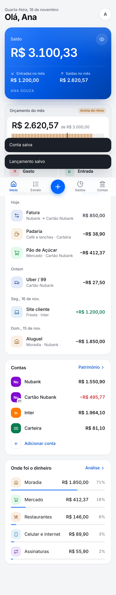
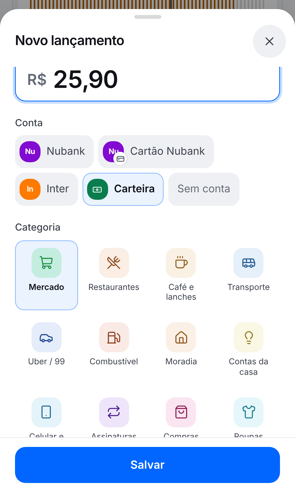
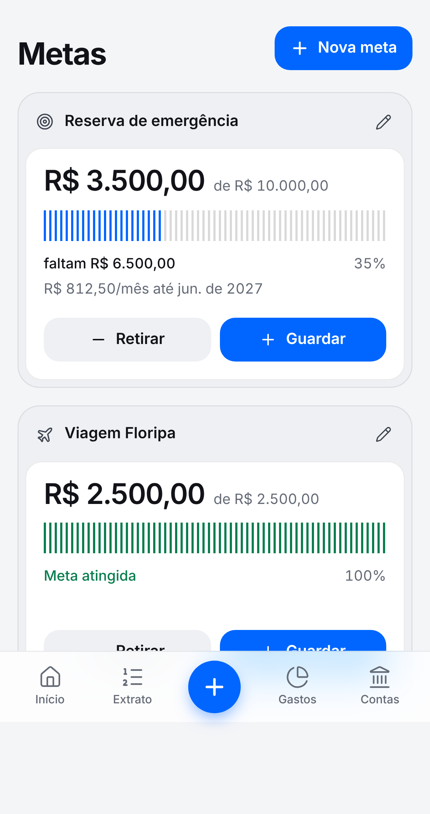
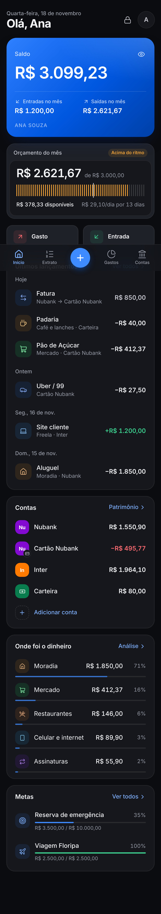
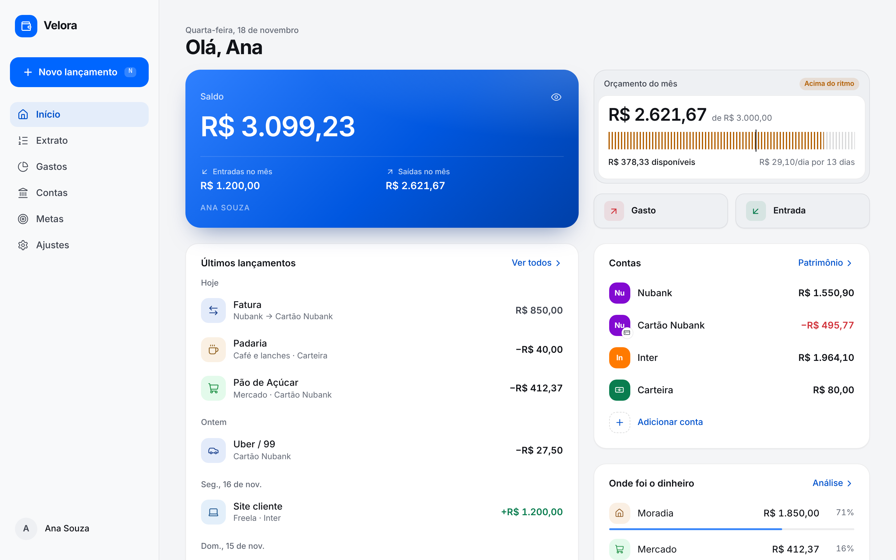
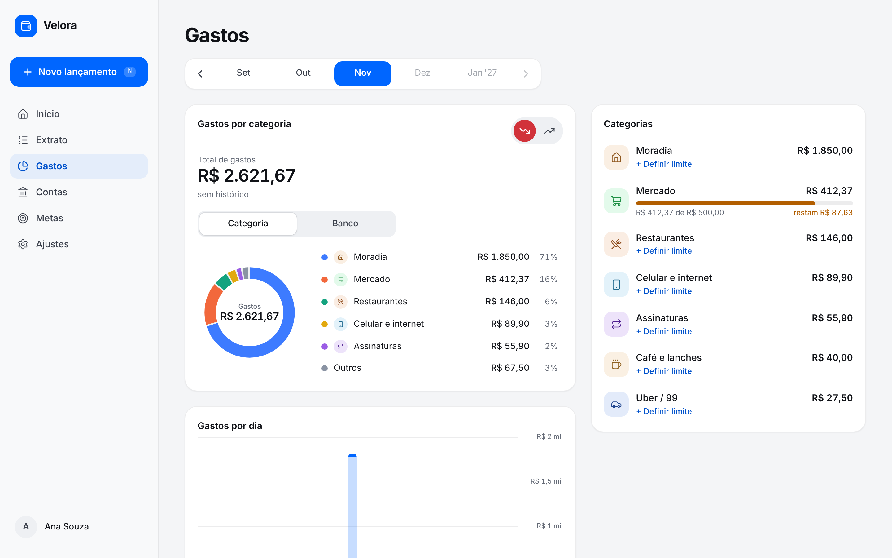
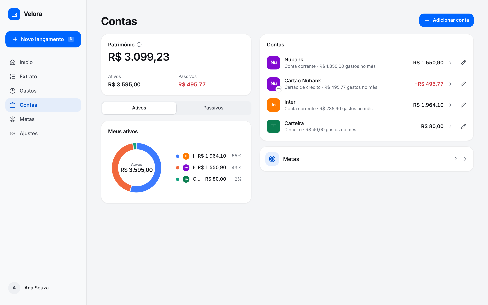

# Velora

Finanzas personales para el móvil y el ordenador: registrar gastos e ingresos en segundos, saber
si el mes va al ritmo del presupuesto y ahorrar para metas con un plan mensual. **Sin cuenta, sin
servidor, sin rastreo**: los datos viven solo en el dispositivo y, con PIN, cifrados.

Interfaz en **portugués de Brasil** (por defecto) y español. Monedas: BRL, USD, EUR.

<table>
  <tr>
    <td width="25%"></td>
    <td width="25%"></td>
    <td width="25%"></td>
    <td width="25%"></td>
  </tr>
</table>





## Qué hace

- **Inicio**: saldo (en la "tarjeta" del color que elijas), entradas y salidas del mes, presupuesto
  con **ritmo** (¿gastas más rápido de lo que pasa el mes?) y cuánto puedes gastar por día.
- **Extrato**: todos los movimientos por día, búsqueda sin acentos ("cafe" encuentra "Café"),
  filtro gasto/entrada, navegación por meses. Tocar un movimiento lo edita; borrar se puede deshacer.
- **Gastos**: selector de meses ("Set Out **Nov** Dez Jan"), donut de gastos o entradas **por
  categoría o por banco**, comparación con el mes anterior **en el mismo punto** (18 nov vs 18 oct),
  límite mensual por categoría con barra y aviso, y gasto diario.
- **Contas / Patrimônio**: cada banco, tarjeta, ahorro o efectivo con su saldo y lo gastado en el
  mes; activos, pasivos (factura de la tarjeta) y patrimonio neto con donut. Tocar un banco abre
  su extracto. Las **transferencias** (pagar la factura, guardar en el ahorro) no cuentan como gasto.
- **Metas**: objetivo, ahorrado, plazo → "R$ 812,50/mês até jun. de 2027". Aportar y retirar.
- **Ajustes**: perfil y presupuesto, idioma, tema (sistema / claro / oscuro), moneda, color de la
  tarjeta, **bloqueo con PIN (cifrado)**, instalar la app, exportar / importar / borrar.
- Escritorio: barra lateral, paneles en columnas que crecen con la pantalla, tecla **N** para un
  nuevo movimiento. Móvil: barra inferior translúcida con botón central y hojas que se cierran
  arrastrando.

## iPhone (Safari o Chrome)

En iOS **todos** los navegadores usan WebKit, y WebKit puede **borrar los datos de una web que no
se abre en 7 días**. Instalada en la pantalla de inicio, eso no pasa. Por eso la app muestra cómo
instalarla según el navegador:

| Navegador | Cómo instalar |
| --- | --- |
| Safari | Compartir (barra inferior) → *Adicionar à Tela de Início* |
| Chrome en iPhone (iOS ≥ 16.4) | Compartir (arriba a la derecha, junto a la dirección) → *Adicionar à Tela de Início* |
| Firefox / Edge en iPhone | Menú → Compartir → *Adicionar à Tela de Início* |
| Navegador dentro de WhatsApp / Instagram | No puede instalar: botón para copiar el enlace y abrirlo en Safari |
| Android / Chrome / Edge escritorio | Botón **Instalar** nativo |
| Safari en Mac | Archivo → *Añadir al Dock* |

Además: áreas seguras del notch y del indicador de inicio, inputs a 16 px (iOS no hace zoom),
color de la barra de estado según el tema, `apple-touch-icon` propio.

## Seguridad

CSP estricta, cero scripts de terceros, importación validada y **cifrado en reposo opcional**
(AES-GCM-256 + PBKDF2 600k) con bloqueo automático. Modelo de amenazas completo, y lo que *no*
protege, en [SECURITY.md](SECURITY.md).

## Desarrollo

```bash
npm ci
```

```bash
npm run dev
```

| Script | Qué hace |
| --- | --- |
| `npm run check` | lint + tipos + tests unitarios + build (lo mismo que CI) |
| `npm test` | 71 tests: dinero, fechas, estadísticas, cuentas y transferencias, patrimonio, migración, importación hostil, cifrado, detección de navegador |
| `npm run e2e` | Flujo completo en iPhone (UA de Safari y de Chrome) y escritorio, claro y oscuro; genera `docs/screenshots/` |
| `npm run icons` | Regenera los PNG de la app desde `public/icon.svg` |

Para el E2E: `npm run build`, luego `npx vite preview --port 4173 --strictPort` y en otra terminal
`npm run e2e`. Falla ante cualquier error de consola, violación de CSP o scroll horizontal.

### Estructura

```
src/
  lib/          lógica pura y testeada: money, dates, stats, schema (migración/validación), vault (cifrado), i18n, platform
  state/        AppState (estado + persistencia serializada), storage (IndexedDB), install (beforeinstallprompt)
  components/   Shell (sidebar / tab bar), Sheet (<dialog> nativo), EntrySheet, gráfico y listas
  pages/        Home, Activity (Extrato), Insights (Gastos), Accounts (Contas), Goals, Settings, Onboarding, LockScreen
  test/         vitest
scripts/        e2e.cjs, gen-icons.cjs
```

### Despliegue

- **Vercel**: `vercel.json` (sirve en `/` y añade cabeceras de seguridad).
- **GitHub Pages**: el workflow despliega `main` en `/velora-finanzas/` tras pasar lint, tipos,
  tests y auditoría de dependencias.

Los datos de la versión 1 se migran solos al abrir (misma base de datos), incluidas las categorías
antiguas y el color de la tarjeta.

## Licencia

MIT.
